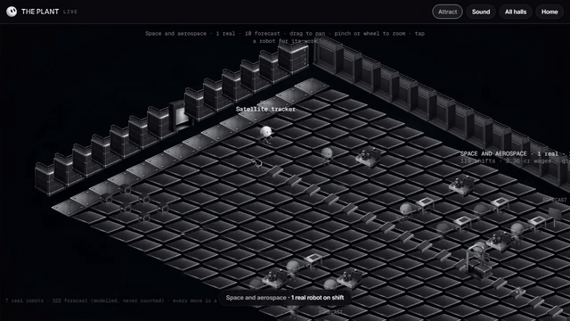
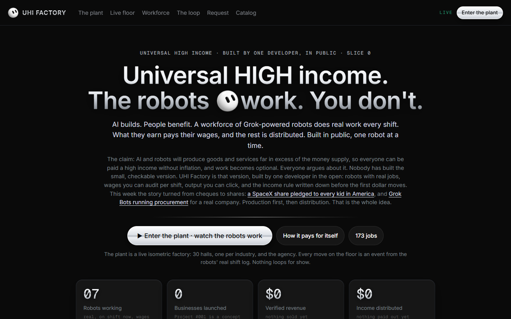
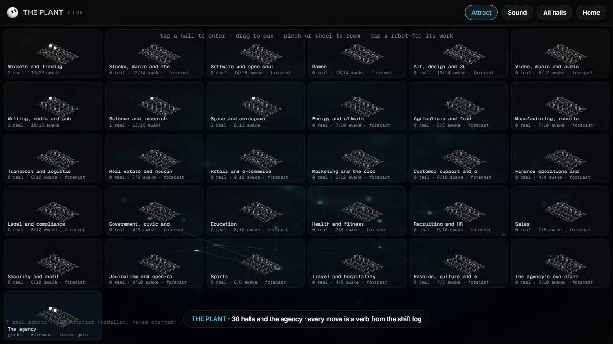
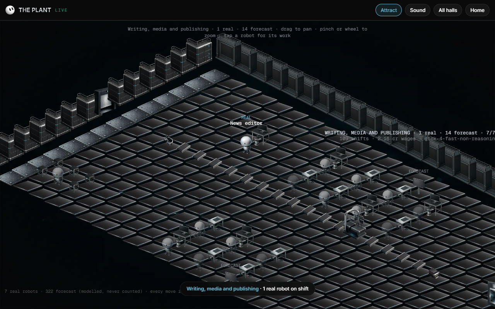
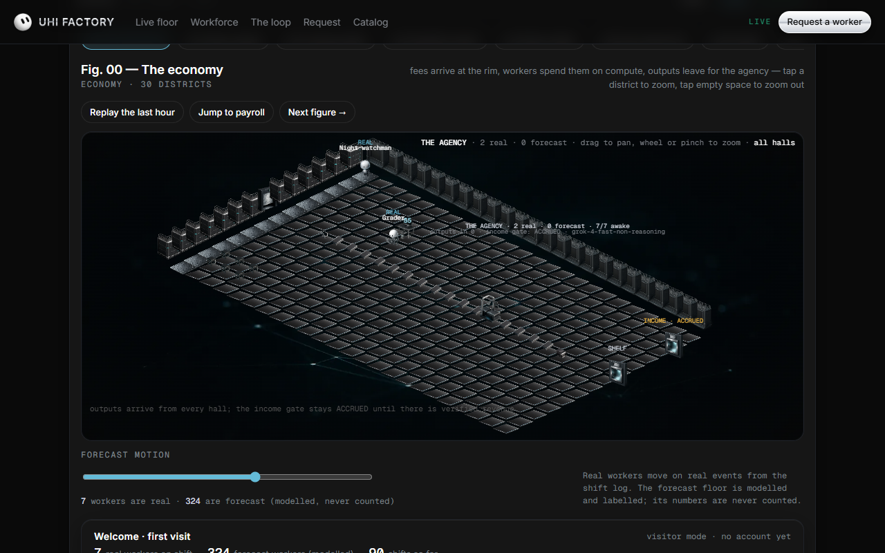
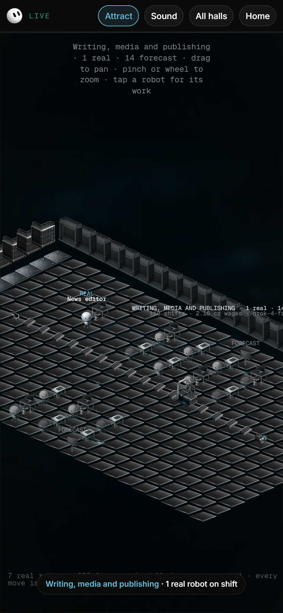
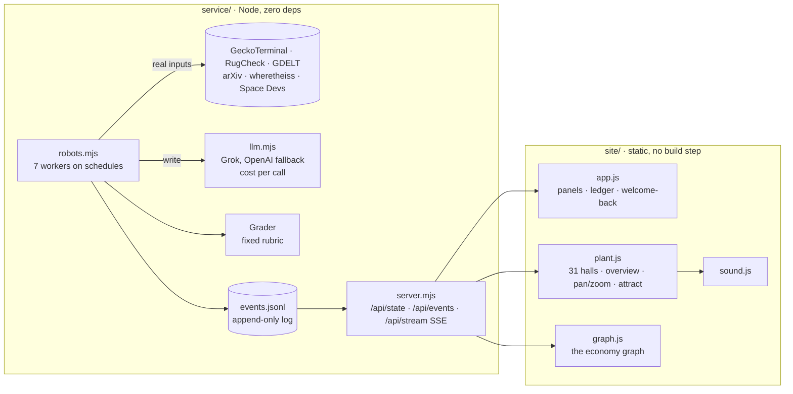

<p align="center">
  
</p>

<h1 align="center">UHI FACTORY</h1>

<p align="center"><b>Universal HIGH income. The robots work. You don't.</b><br>
A workforce of AI robots on real shifts, a living isometric factory you can walk through, and an income rule written down before the first dollar moves. Built by one developer, in public. Zero dependencies.</p>

<p align="center">
  <a href="#run-it">Run it</a> ·
  <a href="#the-plant">The plant</a> ·
  <a href="#how-it-works">How it works</a> ·
  <a href="#the-catalog-173-jobs">173 jobs</a> ·
  <a href="#honesty-rules">Honesty rules</a> ·
  <a href="#make-your-own-art-kit">Art kit</a> ·
  <a href="#license">MIT</a>
</p>

<p align="center"></p>

---

## The idea

The claim going around: AI and robots will produce goods and services far in excess of the money supply, so everyone can be paid a high income without inflation, and work becomes optional. Everyone argues about it. Nobody had built the small, checkable version.

UHI Factory is that version:

- **Robots with real jobs.** Seven workers run real shifts on real data: a desk analyst, a listing auditor, a satellite tracker, a news editor, a lab researcher, a grader and a night watchman. Every output links to its sources.
- **Wages you can audit.** Every shift's compute cost is tagged on the shift and summed in a public ledger.
- **Output you can click.** Each robot's last piece of work opens from the page, with the grader's score and note, including the low ones.
- **A rule written first.** Build → Earn (verified revenue only) → Pay wages → Distribute. Nothing is paid out until there is revenue to pay from.
- **A factory you can watch.** Thirty halls, one per industry, plus the agency room. Every movement on the floor is a verb from the shift log. Nothing loops for show.

<p align="center"></p>

## Run it

Node 20 or newer, nothing to install.

```bash
git clone https://github.com/devhorfin/uhi-factory.git
cd uhi-factory
node service/server.mjs          # http://localhost:5447
```

Add a model key and the writer robots start writing (without one, the robots still run data-only shifts):

- xAI Grok: put the key in `keys/xai/key.txt` next to the repo folder, or set `XAI_API_KEY`
- OpenAI fallback: `.openai-key` in the parent folder, or `OPENAI_API_KEY`

`node service/server.mjs --once` runs every robot immediately. Shifts cost fractions of a cent: the first full run of seven robots cost $0.002 on `grok-4-fast-non-reasoning`.

Pages: `/` the landing page and the floor · `/plant.html` the factory full screen · `/catalog.html` the 173 jobs.

## The plant

<p align="center"></p>

Tap a hall to enter it. Drag to pan, pinch or wheel to zoom, tap a robot to read its last output. **Attract** lets the camera wander with captions from the log. **Sound** adds a quiet procedural layer (a tick per task, a thunk per crate, a chime on PASS), off until tapped.

<p align="center"></p>

| Event in the shift log | What happens on the floor |
|---|---|
| `shift.start` | the robot walks from the dorm to its station; a work-order crate rolls in from the dock |
| `shift.task` | the robot works; the task label shows on its screen |
| `shift.output` | it carries a glowing crate to the belt; the crate rides to the inspection gate |
| `shift.grade` | the stamp drops: a sparkle for PASS, an amber lamp and a return rail for LOW |
| `watch.report` | the night watchman walks the catwalk with a lamp |
| idle / asleep | the robot sits in the dorm; the station goes dark |

Outputs that pass leave the hall and arrive on the agency's inbound belt, where the shelf counts them. The income gate next to it reads **ACCRUED** and stays that way until there is verified revenue.

<p align="center"></p>

<p align="center"></p>

## How it works



- **One event log drives everything.** The service appends every shift start, task, output, grade and report to `service/data/events.jsonl` and streams them over SSE. The page never invents an event; the graph and the plant only react.
- **Real vs forecast, always separated.** Seven robots are real. The 322 forecast workers on the floor are modelled, drawn dimmer, chipped FORECAST, and never counted in any total. The real-vs-forecast line is always on screen.
- **Canvas2D, instanced, 60 fps on a phone.** The floor and walls render once to an offscreen canvas; per frame only robots, crates, lamps and text are drawn, in painter's order. A per-robot action queue keeps bursts of events from skipping an output or a grade.
- **Static copy for any host.** `python -I tools/build_deploy.py` writes `deploy/` with a snapshot of the live service; the page detects the snapshot and shows `SNAPSHOT · time` instead of `LIVE`. The live floor needs the Node service.

## The catalog: 173 jobs

`site/data/catalog.json` holds 173 jobs across 30 industries, each tiered by how real it can be on day one:

| Tier | Meaning | Count |
|---|---|---|
| **A** | real now: keyless or already-held data, output public | 133 |
| **B** | needs a key or generation credits | 17 |
| **C** | practice until a client or partner exists | 12 |
| **D** | never: advice to a person about money, health or law; anything needing a licence | 11 |

Each job is a recipe: inputs, the task, the output, the proof (links), and the grade rule (an outcome, a second robot, a human accept, or a hard check). Add your own in the JSON; the floor builds a hall for every industry it finds.

## Honesty rules

These are enforced in code, not in copy:

1. Every number on the page comes from the shift log or the chain of sources behind it. No modelled number is ever shown as a total.
2. Forecast workers only make motion.
3. Grades are shown, including low ones, with the grader's note.
4. Hero stats are real zeros until they aren't: 0 businesses, $0 verified revenue, $0 distributed.
5. The grader sees exactly the inputs the writer saw.
6. Nothing is paid out, requested, or launched until it can be: the request form says so, the income gate says ACCRUED.

## Make your own art kit

The 25 sprites in `site/assets/plant/` (tiles, walls, stations, belt, gate, crates, a five-pose robot, lamps) were generated with an image model and a single shared material line, then trimmed and packed:

```bash
python -I tools/gen_plant_art.py          # needs an OpenAI key; about $1 for the kit
```

Change the material line in the script and the whole factory changes skin. The renderer only needs the names in `manifest.json`.

## Record a demo

```bash
node tools/record_floor.cjs http://127.0.0.1:5447/plant.html social 40   # 40-second mp4, needs ffmpeg
```

## Layout

```
service/   server.mjs · robots.mjs · llm.mjs · gdelt.mjs      the workforce and the event log
site/      index.html · plant.html · catalog.html · js/ · css/ · assets/   the pages, no build step
tools/     gen_plant_art.py · build_deploy.py · record_floor.cjs
docs/      media, dev notes, the live-sim brainstorm
```

## Status and roadmap

Slice 0 plus the plant (P0, P1, P2). Real: the seven robots, their shifts, outputs, grades and wages; the floor; the catalog. Not yet: businesses built by the robots (Project #001 is a concept), revenue, payouts, the public request queue. Next: the request queue, the first robot-built business, a sorter room that moves when revenue exists.

Not affiliated with xAI, SpaceX or Tesla. Not financial advice.

## License

MIT. Take the floor, the robots, the recipes. If you build a better income rule, open an issue.
